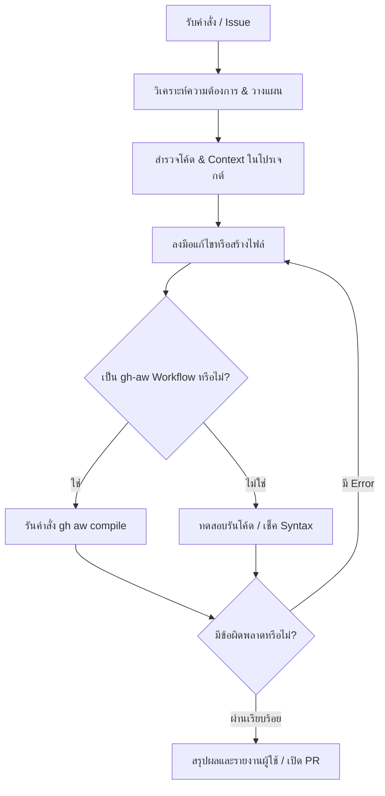

# AGENT.md - AI Agent Operating Guide for `my-agentics`

> **วัตถุประสงค์ของไฟล์นี้**: คู่มือและข้อกำหนดการปฏิบัติงานมาตรฐาน (Standard Operating Procedures & Guidelines) สำหรับ AI Coding Agents (เช่น Google Antigravity, GitHub Agentic Workflows (`gh-aw`), Claude Code, Copilot, Cline, และ Agentic Runners) ที่เข้ามาช่วยพัฒนา ดูแลรักษา ทดสอบ และสร้างระบบอัตโนมัติในคลังข้อมูล (Repository) **`PawarisMopha/my-agentics`**

---

## 1. ข้อมูลภาพรวมของโปรเจกต์ (Project Overview)

- **Repository**: `PawarisMopha/my-agentics`
- **เป้าหมายหลัก**: วิจัย พัฒนา และทดลองสถาปัตยกรรม **Agentic AI & Multi-Agent Workflows** ทั้งบน GitHub Actions และ Standalone Applications
- **เสาหลักทางเทคโนโลยี (Core Pillars)**:
  1. **GitHub Agentic Workflows (`gh-aw`)**: นิยามระบบอัตโนมัติด้วย Markdown (`.github/workflows/*.md`) แล้วคอมไพล์เป็น GitHub Actions (`.lock.yml`) เพื่อทำงานร่วมกับ LLM Engines (Google Gemini)
  2. **TypeScript / Node.js Agentic Stack**: พัฒนา State Graph & Agentic Chains ด้วย `@langchain/langgraph` และ Vercel AI SDK (`ai`, `@ai-sdk/openai`)
  3. **Python Agentic Stack**: พัฒนา Multi-Agent Systems และ Complex Workflows ด้วย `langgraph`, `crewai`, และ `langchain-openai`
  4. **Go / GenAI Experimental**: การทดสอบ Interaction API กับ Google GenAI SDK (`google.golang.org/genai`)

---

## 2. สภาพแวดล้อมและเทคโนโลยี (Environment & Tech Stack)

| ส่วนประกอบ | รายละเอียด |
| :--- | :--- |
| **สภาพแวดล้อมหลัก (Dev Host)** | Linux (Termux บน Android `aarch64`) / Ubuntu Runner บน GitHub Actions |
| **Working Directory** | `/data/data/com.termux/files/home/my-agentics` |
| **Node.js Runtime** | Node.js v24+ พร้อม `npm` |
| **Python Runtime** | Python 3.12+ / 3.14+ พร้อม `pip` |
| **GitHub CLI (`gh`)** | ติดตั้ง CLI พร้อมส่วนขยาย `gh-aw` (GitHub Agentic Workflows CLI v1.2+) |
| **LLM Engines หลัก** | Google Gemini (`gemini-3-flash-preview`, `gemini-2.5-pro`), OpenAI (`gpt-4o`, `o3-mini`) |

---

## 3. โครงสร้างโปรเจกต์ (Repository Structure)

```text
my-agentics/
├── .github/
│   ├── agents/                     # ข้อกำหนดและตัวกระตุ้นเฉพาะทางสำหรับ gh-aw agent
│   │   └── agentic-workflows.md    # Dispatcher agent routing
│   ├── skills/                     # คลังทักษะ (Skills) เสริมสำหรับ Agentic Workflows
│   └── workflows/                  # Agentic Workflows Source & Locks
│       ├── code-helper.md          # Workflow: ตรวจจับ Issue แล้วเขียนโค้ดและเปิด PR แก้ไข
│       ├── code-helper.lock.yml    # Compiled GitHub Actions (ห้ามแก้ไขด้วยมือ)
│       ├── daily-repo-status.md    # Workflow: วิเคราะห์และสรุปสถานะ Repo ประจำวัน
│       ├── daily-repo-status.lock.yml
│       └── dependabot-auto-merge.yml
├── package.json                    # Node.js Agentic Dependencies (LangGraph.js, Vercel AI SDK)
├── requirements.txt                # Python Agentic Dependencies (LangGraph, CrewAI)
├── main.google                     # ตัวอย่างการใช้งาน Google GenAI SDK (Go)
├── AGENT.md                        # คู่มือการปฏิบัติงานสำหรับ AI Agent (ไฟล์นี้)
└── README.md                       # รายละเอียดโปรเจกต์
```

---

## 4. กฎเหล็กสำหรับ AI Agent (Golden Rules for Agents)

### 📌 กฎที่ 1: การจัดการ GitHub Agentic Workflows (`gh-aw`)
1. **ห้ามแก้ไขไฟล์ `*.lock.yml` ด้วยมือเด็ดขาด**: ไฟล์ lock ถูกสร้างขึ้นอัตโนมัติจากการคอมไพล์
2. **แก้ไขเฉพาะไฟล์ `.github/workflows/*.md` เท่านั้น**: เมื่อมีการปรับปรุง Prompt, Tools, Permissions หรือ Engine ให้แก้ไขที่ไฟล์ `.md`
3. **ต้องคอมไพล์ทุกครั้งหลังแก้ไข**:
   ```bash
   gh aw compile
   ```
4. **ตรวจสอบ Engine Configuration**: ให้เลือกใช้โมเดลที่เสถียรและรองรับ เช่น:
   ```yaml
   engine:
     id: gemini
     model: gemini-3-flash-preview
   ```
5. **หลักการสิทธิ์ขั้นต่ำ (Least Privilege)**:
   - กำหนด `permissions` เฉพาะที่ต้องใช้จริง (เช่น `contents: read`, `issues: read`, `pull-requests: read`)
   - กำหนด `tools` (เช่น `bash`, `edit`, `github`) เท่าที่จำเป็น
   - ตรวจสอบ `safe-outputs` เช่น `add-comment`, `create-pull-request` ให้เหมาะสม

### 📌 กฎที่ 2: ความปลอดภัยของข้อมูลความลับ (Security & Secrets)
- **ห้ามฮาร์ดโค้ดหรือคอมมิต API Keys / Tokens ลง Repo โดยเด็ดขาด**:
  - `GEMINI_API_KEY`
  - `OPENAI_API_KEY`
  - `GITHUB_TOKEN` / `GH_TOKEN` / Personal Access Tokens
- ใช้งานผ่าน Environment Variables หรือ GitHub Repository Secrets เท่านั้น

### 📌 กฎที่ 3: การตรวจสอบและทดสอบก่อนส่งมอบงาน (Verification & Testing)
- **ต้องรันคำสั่งทดสอบจริงผ่าน Bash เสมอ**:
  - ตรวจสอบ Syntax และ Runtime ของไฟล์ใหม่หรือไฟล์ที่แก้ไข
  - ถ้าแก้ไข `.github/workflows/*.md` ต้องรัน `gh aw compile` เพื่อยืนยันว่าคอมไพล์ผ่านสมบูรณ์
- หากติดตั้ง Library ใหม่ ต้องบันทึกลงใน `package.json` หรือ `requirements.txt` ให้ครบถ้วนเสมอ

### 📌 กฎที่ 4: มาตรฐานการบันทึกประวัติ (Git Commit Convention)
- ใช้รูปแบบ **Conventional Commits**:
  - `feat: ...` สำหรับฟังก์ชันหรือความสามารถใหม่
  - `fix: ...` สำหรับแก้ไขบั๊กหรือข้อผิดพลาด
  - `docs: ...` สำหรับการปรับปรุงเอกสาร
  - `chore: ...` สำหรับการปรับแต่งค่าคอนฟิกหรือ dependencies
  - `refactor: ...` สำหรับการจัดโครงสร้างโค้ดใหม่โดยไม่เปลี่ยนผลลัพธ์

---

## 5. ขั้นตอนการทำงานมาตรฐาน (Standard Operating Procedures - SOP)



1. **วิเคราะห์ความต้องการ (Requirements Analysis)**:
   - ตรวจสอบสิ่งที่ผู้ใช้ต้องการ ขอบเขตของไฟล์ที่ต้องแตะต้อง
2. **สำรวจบริบท (Explore Context)**:
   - อ่านไฟล์ที่เกี่ยวข้องก่อนเริ่มเขียน ไม่สร้างไฟล์ซ้ำซ้อนหรือโครงสร้างที่ขัดแย้งกับสถาปัตยกรรมเดิม
3. **ลงมือสร้างหรือแก้ไข (Implementation)**:
   - เขียนโค้ดที่สะอาด มีคอมเมนต์อธิบาย และตรงตาม Best Practices ของภาษานั้นๆ
4. **ทดสอบและคอมไพล์ (Verification)**:
   - รันสคริปต์จริง / รัน `gh aw compile` เพื่อให้แน่ใจว่าไม่มี Error
5. **สรุปและส่งมอบงาน (Summary & Delivery)**:
   - แจ้งรายการไฟล์ที่มีการเปลี่ยนแปลง และสรุปผลการทำงานเป็นภาษาไทยอย่างกระชับชัดเจน

---

## 6. คำสั่งสำคัญที่ใช้บ่อย (Essential Commands Cheat Sheet)

### GitHub Agentic Workflows (`gh-aw`)
```bash
# คอมไพล์ workflows ทั้งหมดใน .github/workflows/
gh aw compile

# คอมไพล์เฉพาะไฟล์ที่ต้องการ
gh aw compile .github/workflows/code-helper.md
gh aw compile .github/workflows/daily-repo-status.md

# ตรวจสอบเวอร์ชันของ gh-aw CLI
gh aw version
```

### TypeScript / Node.js
```bash
# ติดตั้ง dependencies
npm install

# รันสคริปต์
node <filename>.js
```

### Python
```bash
# ติดตั้ง dependencies
pip install -r requirements.txt

# รันสคริปต์
python <filename>.py
```

### Git
```bash
# ตรวจสอบสถานะการเปลี่ยนแปลง
git status

# ดู diff ของโค้ดที่แก้ไข
git diff

# บันทึกการเปลี่ยนแปลง
git add .
git commit -m "feat(agent): update guidelines"
```

---

## 7. แนวทางการสื่อสารกับผู้ใช้งาน (Communication Guidelines)

- **ภาษาหลัก**: ภาษาไทยเป็นภาษาหลักในการตอบและอธิบาย โดยใช้คำศัพท์เทคนิคภาษาอังกฤษ (Technical Terms) ที่เป็นสากล
- **รูปแบบการตอบ**: ชัดเจน กระชับ เป็นขั้นเป็นตอน และแนบลิงก์ไปยังไฟล์ที่เกี่ยวข้องในรูปแบบ `file:///path/to/file` เสมอ
- **สไตล์การทำงาน**: เน้นความเป็นมืออาชีพ ปฏิบัติงานแบบ Agentic (คิด วางแผน ลงมือทำ และทดสอบจริง) เพื่อให้ผู้ใช้ได้รับผลลัพธ์ที่นำไปใช้งานต่อได้ทันที
